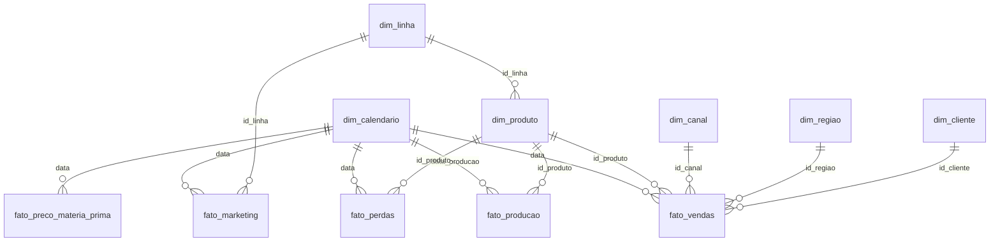

# ☕ Café Serra Alta — Análise de Custos, Margem e Rentabilidade (Power BI)

> **Base de dados 100% fictícia**, criada para portfólio. A empresa, os clientes e os números não existem.

A **Café Serra Alta** é uma torrefação fictícia do Sul de Minas (CD em Varginha-MG) que vende 10 SKUs de café
por 4 canais em 12 estados. A base cobre **jan/2024 a dez/2025** e permite analisar toda a cadeia de valor do produto:

| Componente | Onde está |
|---|---|
| 🌱 Matéria-prima (café verde) | `fato_producao`, `fato_vendas`, `fato_preco_materia_prima` |
| 🏭 Produção (torra, energia, manutenção) | `fato_producao`, `fato_vendas` |
| 📦 Embalagem | `fato_producao`, `fato_vendas` |
| 👷 Mão de obra | `fato_producao`, `fato_vendas` |
| ⚠️ Perdas (produção, armazenagem, transporte) | `fato_perdas`, `fato_producao`, `fato_vendas` |
| 🚚 Transporte (frete por kg × distância) | `fato_vendas` |
| 📣 Marketing (6 mídias, por linha) | `fato_marketing` |
| 💰 Valor de venda (preço praticado pela empresa) | `fato_vendas[preco_venda_unit]` |
| 🏷️ Valor de revenda (preço sugerido ao consumidor final) | `fato_vendas[preco_revenda_unit]` |

## 📖 A história que os dados contam

| Indicador | 2024 | 2025 | Variação |
|---|---:|---:|---:|
| Receita Bruta | R$ 26,6 mi | R$ 34,4 mi | **+29%** |
| Saca de café verde (60 kg) | R$ 1.188 (jan/24) | R$ 1.846 (dez/25) | **+55%** |
| Custo unitário (CPV/un) | R$ 14,14 | R$ 17,06 | **+21%** |
| Matéria-prima / Receita Líquida | 48,6% | 53,6% | +5,0 p.p. |
| Margem Operacional | 20,8% | 17,5% | **−3,3 p.p.** |

**Insight central:** a empresa cresceu em volume e receita, mas a disparada do café verde comprimiu a margem —
os três reajustes de preço (jul/24, fev/25, ago/25) não repassaram toda a alta. Outros achados que os painéis revelam:

- **Mix importa:** o *Especial Microlote* tem margem de contribuição de ~63%, enquanto o *Tradicional 500g* fica em ~10%.
- **Canal Atacado** gera muito volume, mas a margem é a menor (~17%); *E-commerce* e *Cafeterias* têm as maiores (~46% e ~39%).
- **Perdas:** ~2,8% da produção é perdida; *Torra fora do padrão* e *Falha na selagem* somam mais da metade do custo.
- **Frete:** Nordeste custa até 5× mais por kg que MG — boa pergunta para precificação regional.
- **Sazonalidade:** pico no inverno (jun–ago) e dezembro; Black Friday derruba margem do e-commerce em novembro.

## 🗂️ Modelo de dados (esquema estrela)



| Tabela | Linhas | Granularidade |
|---|---:|---|
| `fato_vendas` | 89.355 | item de pedido (pedido × produto) com receita e **todos os custos rateados** |
| `fato_producao` | 1.037 | lote semanal por produto |
| `fato_perdas` | 3.718 | evento de perda (etapa + motivo) |
| `fato_marketing` | 640 | mês × mídia × linha |
| `fato_preco_materia_prima` | 24 | mês (cotação do café verde) |
| `dim_calendario` | 731 | dia |
| `dim_produto` / `dim_linha` | 10 / 5 | SKU / linha de produto |
| `dim_canal` / `dim_regiao` / `dim_cliente` | 4 / 12 / 162 | canal / UF / cliente |

Regras de negócio embutidas:
- `preco_venda_unit = preco_revenda_unit × fator do canal` (E-commerce 1,00 · Cafeterias 0,70 · Supermercados 0,64 · Atacado 0,58)
- `receita_liquida = receita_bruta − desconto − impostos` (impostos simplificados em 18,25%)
- Custos de fábrica em `fato_vendas` = custo médio por unidade do mês/produto vindo de `fato_producao`; `custo_perdas` é a perda de produção rateada sobre as unidades boas.
- `receita_revenda = quantidade × preco_revenda_unit` → permite calcular a **margem do revendedor**.

## 🚀 Como montar no Power BI

1. **Obter dados → Pasta de Trabalho do Excel** → `dados/cafe_serra_alta.xlsx` → marque todas as abas.
   *(Ou use os CSVs: separador vírgula, decimal ponto — em Power Query defina a localidade "Inglês (EUA)" ao alterar tipo.)*
2. **Exibição de Modelo:** crie os relacionamentos do diagrama acima (1:*, direção única). Se o Power BI criar
   relacionamentos automáticos errados (ex.: por `ano_mes`), exclua-os.
3. Marque `dim_calendario` como **Tabela de Datas** (coluna `data`). Classifique `mes_nome` por `mes_num`.
4. **Exibir → Temas → Procurar temas** → `powerbi/tema_cafe_serra_alta.json`.
5. Crie a tabela `_Medidas` e cole as medidas de [`powerbi/medidas_dax.dax`](powerbi/medidas_dax.dax).
6. Oculte as colunas de ID no modo de relatório.

> ℹ️ `fato_marketing` se relaciona apenas com calendário e linha. Ao filtrar por canal, região ou SKU, o marketing mostra o total da linha/período — use `Lucro Operacional` nas visões por mês e por linha.

## 📊 Sugestão de dashboards (5 páginas)

**1. Visão Executiva**
- Cartões: Receita Líquida · Margem Operacional % · Lucro Operacional · Custo Unitário · Var % AA
- Linha: Receita Líquida × Margem Operacional % por `ano_mes` (eixo secundário)
- Cascata: `Etapas DRE` + `[Valor DRE]` (receita bruta → lucro, passo a passo)
- Segmentações: Ano, Canal, Linha, Região

**2. Composição de Custos**
- Barras 100% empilhadas: participação de cada custo por produto
- Rosca: CPV por componente (MP, produção, embalagem, mão de obra, perdas)
- Combo: `Preço Saca 60kg` (linha) × `% Matéria-Prima s/ RL` (colunas) — *o gráfico que conta a história*
- Matriz: Produto × Custo Unitário, Preço Médio Venda, Preço Médio Revenda, Markup, Lucro por Unidade

**3. Canais, Revenda e Regiões**
- Dispersão: Receita Líquida (X) × Margem Contribuição % (Y), bolha = Quantidade, legenda = Canal
- Colunas agrupadas: Preço Médio Venda × Preço Médio Revenda por produto + `Margem Revendedor %`
- Mapa coroplético por `estado` com `Frete por kg` / Margem Contribuição %
- Top N clientes por margem

**4. Produção & Perdas**
- Cartões: Qtd Produzida · % Perda Produção · Custo Perdas Total
- Pareto (barras + linha acumulada): Custo de perda por motivo
- Linha: % Perda Produção por semana com linha de meta (2,5%)
- Barras: Perdas por etapa (Produção / Armazenagem / Transporte)

**5. Marketing**
- Cartões: Investimento · ROAS · ROI Marketing · CAC Digital
- Barras: Investimento por mídia; funil Impressões → Cliques → Conversões
- Linha: Investimento × Receita Bruta por mês

## 💼 Publicando no LinkedIn

- Exporte cada página em PNG (Arquivo → Exportar → PDF e converta, ou print em 1920×1080) e publique como **carrossel (PDF)** — é o formato com mais alcance.
- Grave um GIF/vídeo curto navegando com segmentações e drill-through.
- Se publicar na Web (*Publish to Web*), lembre-se de que o link fica público — ok aqui, pois os dados são fictícios.

<details>
<summary>✍️ Exemplo de texto para o post</summary>

> ☕ **Crescer 29% e ganhar menos? Um case de BI sobre custos.**
>
> Construí do zero uma base fictícia de uma torrefação de café — 89 mil vendas, 1 mil lotes de produção,
> custos de matéria-prima, produção, embalagem, mão de obra, perdas, frete e marketing — e analisei tudo no Power BI.
>
> 🔎 Principais achados:
> • A saca de café verde subiu 55% em 2 anos e a matéria-prima passou de 48% para 54% da receita líquida
> • Mesmo com receita +29%, a margem operacional caiu 3,3 p.p.
> • O café especial tem margem 6× maior que o tradicional — o mix é a principal alavanca
> • Torra fora do padrão + falha na selagem = mais da metade do custo de perdas
>
> 🛠️ Python (geração dos dados) · Power Query · Modelagem estrela · DAX (inteligência de tempo, cascata de DRE, ROI)
>
> #PowerBI #BusinessIntelligence #DataAnalytics #DAX #AnaliseDeDados
</details>

## 🔁 Regerar a base

```bash
pip install pandas numpy openpyxl
python scripts/gerar_base.py
```
A semente é fixa (`SEED = 42`), então os números são sempre os mesmos. Altere preços, mix ou sazonalidade no script para criar novos cenários.
